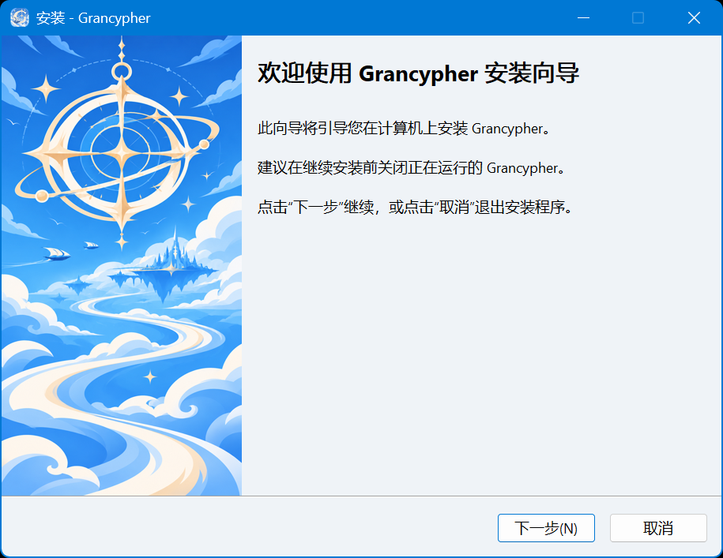

# 安装与环境要求

## 系统要求

- Windows 10 1809（build 17763）或更新版本。
- x64 系统；本次提供 Windows x64 发行包。
- 可写的安装或数据目录，以及足够的磁盘空间。

发行包已包含 Qt 6、CEF 和运行库。无需额外安装 WebView2、.NET 或 Windows App SDK。

## 选择发行包

| 类型 | 文件 | 数据保存方式 |
| --- | --- | --- |
| 安装版 | `Setup-win-x64` 的 `.exe` 文件 | 默认使用当前用户的数据目录；可在初始设置中选择位置 |
| 便携版 | `Portable-win-x64` 的 `.zip` 文件 | 默认使用程序目录下的 `Data` 文件夹 |

从 [1.0.0 内测版 Release](https://github.com/rawlkian/grancypher-release/releases/tag/v1.0.0) 下载。文件旁的 `.sha256` 用于核对下载完整性。

## 安装版

1. 完全退出所有 Grancypher 窗口。
2. 运行安装程序，选择语言与安装目录。
3. 按需创建桌面快捷方式，完成安装。
4. 启动程序并完成初始设置。

安装程序支持简体中文、繁體中文、English 和日本語，默认按当前用户安装。

## 便携版

1. 将整个 ZIP 解压到可写文件夹。
2. 双击 `Grancypher.exe`；不要在压缩包内直接运行。
3. 保留同目录的 `portable.flag` 和全部运行文件。

移动或备份便携版前，先完全退出程序，再复制整个目录及 `Data`。

## 从旧版升级

**1.0.0 无法通过旧版程序内自动更新。** 请先阅读[升级说明](updates.md)，备份数据后下载完整包重新安装。不要仅替换主程序文件。
